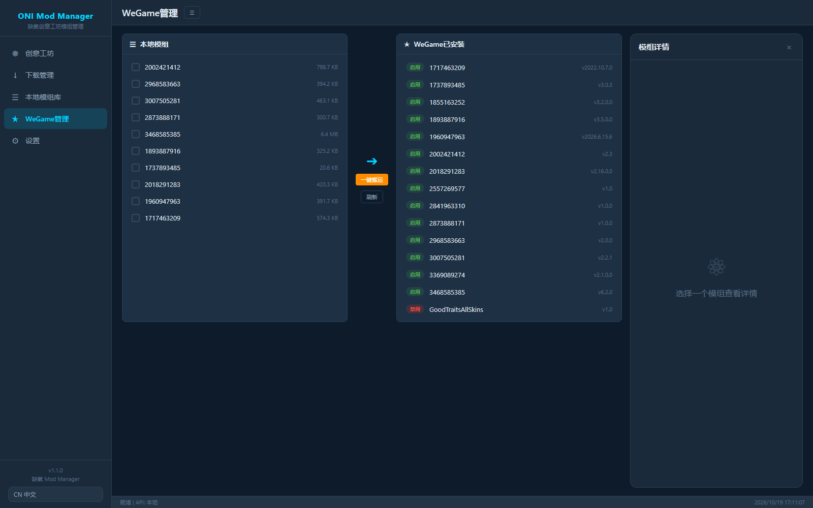

# ONI Mod Manager

> A mod manager for **Oxygen Not Included** players on **WeGame / Epic / offline** builds:
> search the Steam Workshop, download, and one-click deploy into your WeGame copy of ONI.

> **Current version: v1.1.0** (refactored; HTTP API unchanged from v1.0.0 — see [Changelog](CHANGELOG.md))

[中文说明](README.md) · [Changelog](CHANGELOG.md) · [Get a Steam Web API Key](docs/steam-api-key.md)

**📦 Download: [latest v1.1.0 zip](https://github.com/wjznzzz/oni-mod-manager/releases/latest)** (portable — unzip and run `install.bat`)



---

## ⚠️ Disclaimer

- Not an official Klei / Valve / Tencent tool. No affiliation with any of them.
- Data comes from the **official Steam Web API** (public endpoints). No scraping behind
  logins, no paywall bypass.
- Use it only if you **legally own** Oxygen Not Included, and respect the Steam Subscriber
  Agreement and each mod author's license.

## Why

Oxygen Not Included has a Steam Workshop, but the **WeGame / Epic / offline** builds don't.
The mod folder layout is identical across builds
(`Documents\Klei\OxygenNotIncludedTGP\mods`) — only the "subscribe" button is missing.
This tool fills that gap: search → download → extract → register as enabled.

## Features

- **Workshop browser** — search, sort (popular / newest / rating), category filter, grid/list view, detail panel
- **Download manager** — queue, concurrency, live progress & speed, cancel, history, manual ZIP import
- **Local mod library** — reads `mod_info.yaml/json`, previews, delete, open folder
- **WeGame integration** — local ⇄ installed columns, batch deploy, enable/disable via `mods.json`, uninstall
- **Settings** — path auto-detection, download source, concurrency, proxy, API key
- **UI** — dark ONI-inspired theme, i18n for **zh / en / ja / ko / ru**

## Quick start

1. Install [Python 3.8+](https://www.python.org/downloads/) (check *Add Python to PATH*)
2. Double-click **`install.bat`** (creates a venv and installs dependencies)
3. Double-click **`start.bat`** — opens <http://127.0.0.1:9420>

Or manually:

```bash
pip install -r requirements.txt
python app.py
```

Then grab a free Steam Web API key ([guide](docs/steam-api-key.md)) and paste it in
Settings. Without a key the workshop page only shows clearly-labelled sample data.

## How downloads work

| Path | Description | Status |
|------|-------------|--------|
| ① Official API direct link | public `file_url` from `GetPublishedFileDetails` | ✅ primary |
| ② Community page parsing | title / author / description when no key | ⚠️ fallback, no files |
| ③ Third-party relays | opt-in via `allow_third_party_sources` | ⚠️ off by default, mostly dead |
| ④ Manual ZIP import | install a mod package you obtained yourself | ✅ always available |

## Configuration

`config.json` is generated on first run (see `config.example.json`).
Keep secrets in `.env` (git-ignored):

```
STEAM_WEB_API_KEY=your_key
```

## License

[MIT](LICENSE)
